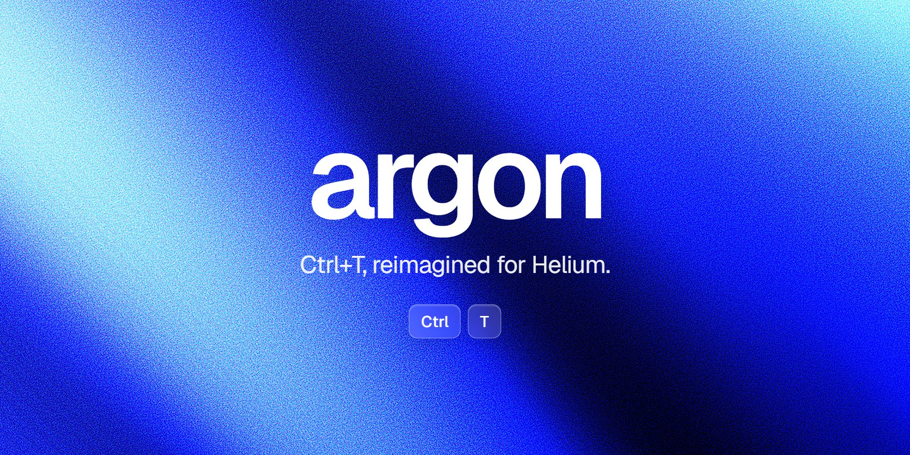
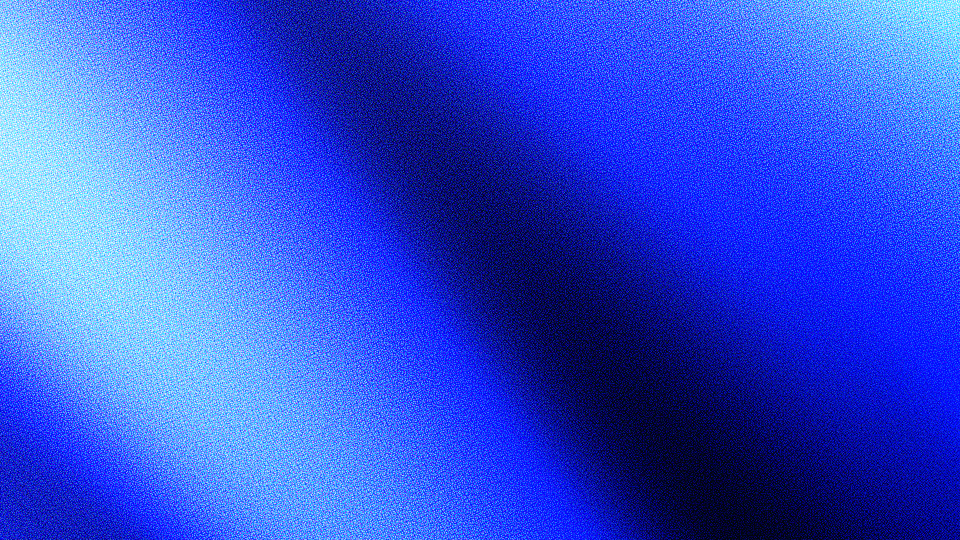
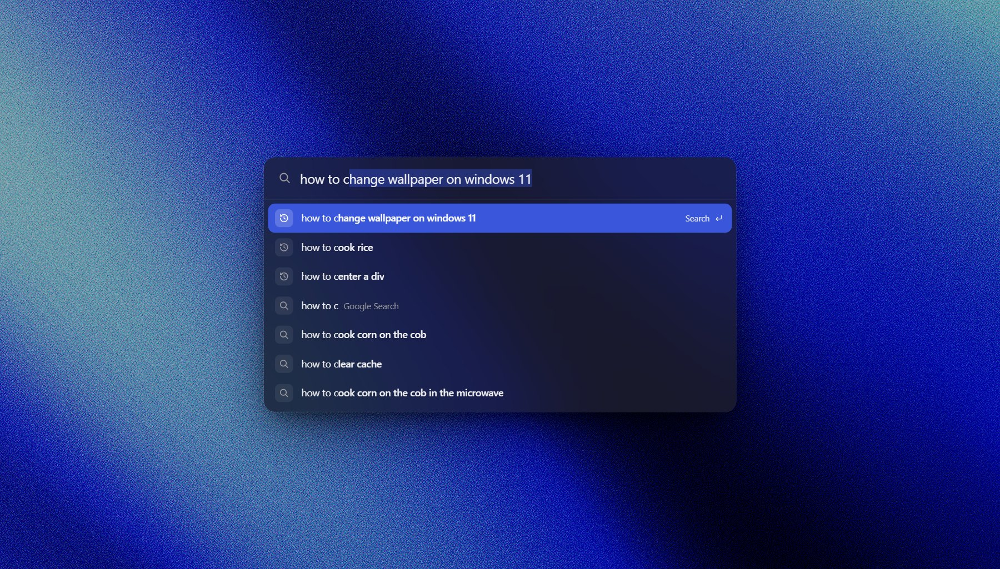
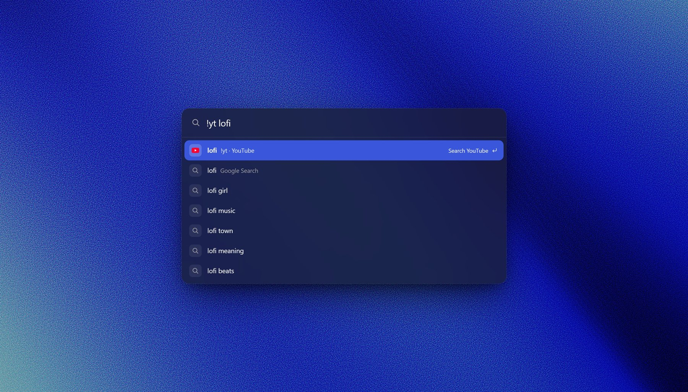
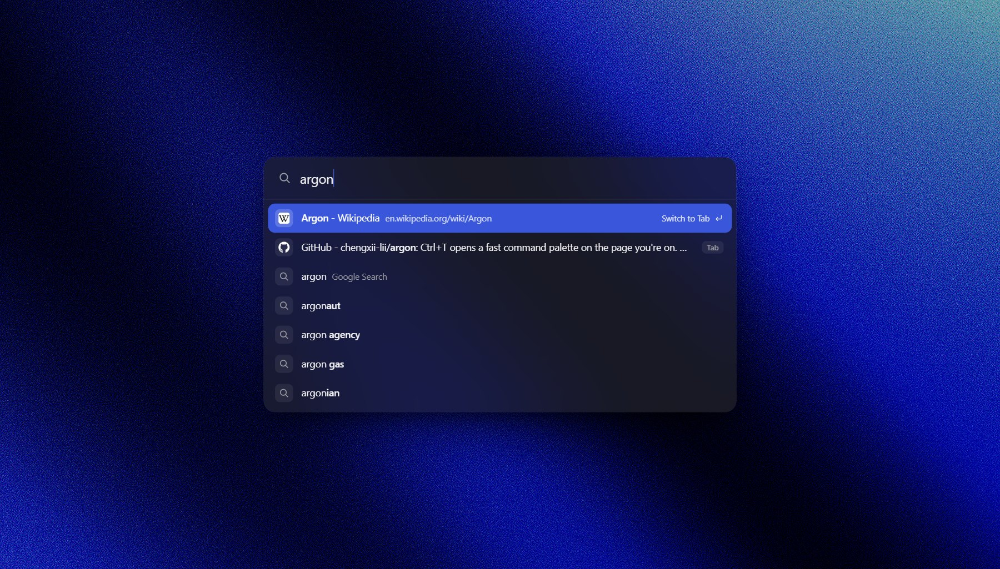
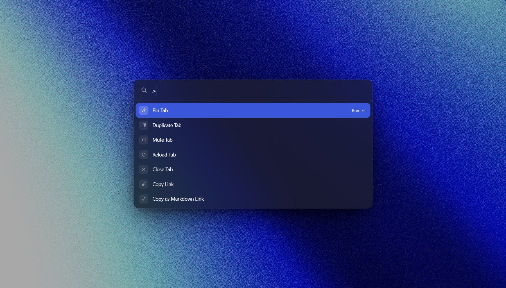

<div align="center">



<br>

[](https://github.com/chengxii-lii/argon/releases/latest)
[](https://helium.computer)
[](LICENSE)

**Ctrl+T opens a command palette on the page you're on, instead of a blank tab.**<br>
Your history first, Google always, and every one of Helium's !bangs.

</div>

<br>



<br>

<table>
<tr>
<td width="50%" valign="top">
<br>
<b>History first, then Google.</b> Inline autofill from what you've searched and visited, and the Google search is always next.
</td>
<td width="50%" valign="top">
<br>
<b>Every Helium !bang.</b> All 13,000+ from Helium's own list, first or last, with suggestions from the bang's site.
</td>
</tr>
<tr>
<td width="50%" valign="top">
<br>
<b>Your open tabs.</b> Pages you have open switch instead of opening twice.
</td>
<td width="50%" valign="top">
' lists commands like Pin Tab, Duplicate Tab and Mute Tab"><br>
<b>Commands.</b> Type <code>&gt;</code> or <code>-</code> to pin, mute, duplicate, copy the link, reopen a closed tab and more.
</td>
</tr>
</table>

**Also:** a calculator (Enter copies the answer) · a calm new tab page · Ctrl+W that never closes a pinned tab or your last one · opens in ~10 ms with no animations · light and dark mode · no tracking.

## Install

1. Download **argon.zip** from the [latest release](https://github.com/chengxii-lii/argon/releases/latest), unzip it, and load the folder at `chrome://extensions` (**Developer mode** → **Load unpacked**).
2. At `chrome://extensions/shortcuts`, set **Open the palette** to <kbd>Ctrl</kbd> <kbd>T</kbd>, and optionally **Close tab** to <kbd>Ctrl</kbd> <kbd>W</kbd>.

Works in any Chromium browser; made for [Helium](https://helium.computer).

## Keys

| Key | Does |
| :-- | :-- |
| <kbd>Tab</kbd> / <kbd>Shift</kbd> <kbd>Tab</kbd> | Cycle suggestions |
| <kbd>Enter</kbd> · <kbd>Shift</kbd> <kbd>Enter</kbd> · <kbd>Ctrl</kbd> <kbd>Enter</kbd> | Open in a new tab · this tab · a background tab |
| <kbd>Alt</kbd> <kbd>Enter</kbd> | Search Google for exactly what you typed |
| <kbd>Shift</kbd> <kbd>Delete</kbd> | Forget a past search or page |
| <kbd>&gt;</kbd> or <kbd>-</kbd> | Commands |

<details>
<summary><b>How it works</b></summary>
<br>

- **On the page itself.** A closed shadow root in the browser's top layer: pages can't restyle it, it sits above fullscreen video, and it hears keys before the page does.
- **Never waiting.** The browser swallows Ctrl+T's key press, but the release still reaches the page, so argon opens right there without asking its background worker.
- **Where it can't draw** (browser pages, the Web Store), Ctrl+T opens argon's new tab with the palette instead.
- **Bangs, the Helium way**, following [Helium's own patch](https://github.com/imputnet/helium/blob/main/patches/helium/core/add-native-bangs.patch).

</details>

<details>
<summary><b>Privacy</b></summary>
<br>

No analytics, accounts or servers. Your history never leaves your browser. argon only fetches Google's suggestions for what you type (`suggestqueries.google.com`) and Helium's public bang list every few days (`services.helium.imput.net`).

</details>

<details>
<summary><b>Development</b></summary>
<br>

No build step: the folder *is* the extension. Scripts need Node 22+ and Helium (or set `BROWSER=/path/to/chromium`).

```bash
npm test         # 57 checks in a real headless browser
npm run bangs    # refresh Helium's bang list
npm run art      # re-render the README art
```

</details>

<sub>Thanks to [Helium](https://github.com/imputnet/helium) and [Kagi](https://github.com/kagisearch/bangs) for the bangs, [ShaderGradient](https://shadergradient.co) for the gradients, and [Geist](https://vercel.com/font) (OFL) for the new tab's font. MIT licensed.</sub>
